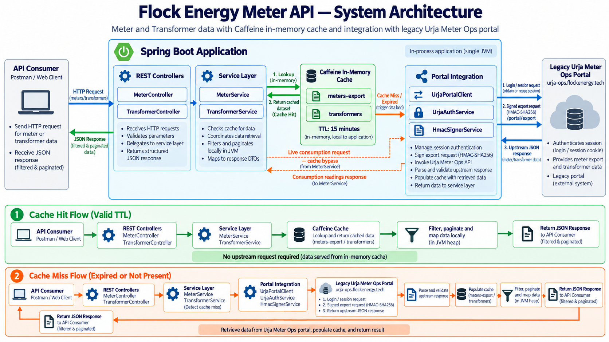
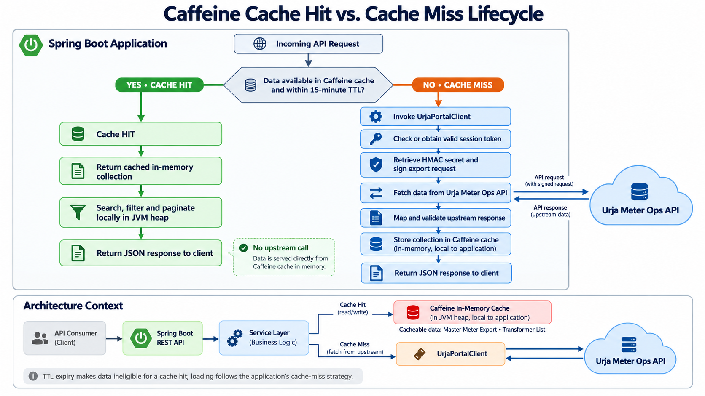

# Urja Meter Ops — Portal Protocol

> **A technical breakdown of how the legacy Urja Meter Ops portal works under the hood: reverse-engineered data surfaces, authentication mechanisms, cryptographic request signing, architectural mediation, and discovered quirks.**

---

## Media & Visual Architecture

### 1. System Architecture


### 2. Cache Hit vs. Cache Miss Lifecycle


### 3. Demo Walkthrough Video

<video src="./Assets/demo_walkthrough_compressed.mp4" poster="./Assets/video_thumbnail.png" controls="controls" style="max-width: 100%; width: 100%;">
  Your browser does not support the video tag.
</video>

---

## 1. Executive Overview

The legacy **Urja Meter Ops portal** (`https://urja-ops.flockenergy.tech`) houses critical operational infrastructure data for Flock Energy: smart meter fleets, 7-level electrical distribution topology, transformer allocations, and time-series consumption telemetry.

However, the legacy system:
- **Lacks a public developer REST API**: The portal was built exclusively as an internal web portal for browser operators.
- **Enforces proprietary session security**: Demands form-based cookie authentication guarded by strict origin validation.
- **Requires cryptographic HMAC signing**: Protects bulk catalog data exports behind symmetric key HMAC-SHA256 signature headers.
- **Fragments operational data**: Distributes meter metadata, geographic coordinates, and transformer mappings across disparate internal routes and paginated HTML-adjacent endpoints.

To solve this, our service functions as an **abstraction, cryptographic mediation, and caching layer**, translating legacy protocols into a standardized, predictable, and sub-millisecond REST API.

---

## 2. Authentication & Session Lifecycle

The upstream portal uses a cookie-based session mechanism (`__Secure-better-auth.session_token`). Direct programmatic requests cannot use standard basic auth or bearer tokens.

### The Login Handshake (`POST /login`)

To establish an authenticated session:
1. **Endpoint**: `POST https://urja-ops.flockenergy.tech/login`
2. **Payload format**: Form URL-encoded (`application/x-www-form-urlencoded`):
   ```text
   email=user%40flockenergy.tech&password=secretpassword
   ```
3. **Mandatory Headers**:
   ```http
   Content-Type: application/x-www-form-urlencoded
   Origin: https://urja-ops.flockenergy.tech
   Referer: https://urja-ops.flockenergy.tech/login
   ```
4. **Session Cookie**: Upon successful authentication (HTTP `200` or `303`), the server responds with:
   ```http
   Set-Cookie: __Secure-better-auth.session_token=abc123xyz...; Max-Age=3600; Path=/; Secure; HttpOnly
   ```

### Programmatic Session Management

In our service implementation (`UrjaAuthService.java`):
- **Thread-Safe Session Caching**: The captured session token is stored in an `AtomicReference<String>`.
- **Thundering-Herd Protection**: Token acquisition is guarded by a `ReentrantLock`. When multiple concurrent threads encounter an expired session, only one thread executes the upstream login handshake; all other threads await completion and reuse the new session token.
- **Self-Healing Re-Authentication**: When the portal rejects a request with HTTP `401 Unauthorized` or `403 Forbidden`, `UrjaPortalClient` invalidates the cached token, triggers a fresh login, and transparently replays the failed request.

---

## 3. Discovered Data Surface & Endpoints

Through network inspection of the portal's client-side application bundles, the following internal endpoints were identified:

| Upstream Endpoint | Method | Auth Required | Request Signing | Description & Data Available |
|:---|:---:|:---:|:---:|:---|
| `/login` | `POST` | No | No | Authenticates user credentials with `Origin` validation; sets `__Secure-better-auth.session_token`. |
| `/portal/meters/search?q={term}&page={page}` | `GET` | Cookie | No | Internal keyword search endpoint; returns paginated basic meter fields (`meterId`, `serialNo`, `make`). |
| `/portal/meters/{meterId}/geo` | `GET` | Cookie | No | Individual meter coordinates; returns `{ "data": { "latitude": 26.938961, "longitude": 75.830957 } }`. |
| `/portal/meters/{meterId}/energy` | `GET` | Cookie | No | Live time-series telemetry; returns 15-minute interval readings (`timestamp`, `kwh`, `kvah`, `voltR`). |
| `/portal/dts?page={page}` | `GET` | Cookie | No | Distribution Transformers (DTs) paginated list: `code`, `name`, `feederCode`, `capacityKva`. |
| `/portal/keys` | `GET` | Cookie | No | Exposes internal frontend secrets, specifically `{ "data": { "signingSecret": "..." } }`. |
| `/portal/export?page=1` | `GET` | Cookie | **HMAC-SHA256** | Bulk catalog export: Complete 403-meter dataset with full 7-level hierarchy and geo-coordinates in a single payload. |

---

## 4. Cryptographic HMAC-SHA256 Request Signing

The most critical and well-defended endpoint on the legacy portal is `/portal/export`. Standard requests bearing only a valid session cookie are rejected with HTTP 401/403.

### Reverse-Engineering the Protocol
By inspecting the portal's JavaScript bundle, we discovered client-side request signing logic:
1. The frontend fetches a cryptographic key from `/portal/keys`:
   ```json
   {
     "data": {
       "signingSecret": "secret-signing-key-string"
     }
   }
   ```
2. The frontend constructs an exact 4-line newline-delimited payload:
   $$\text{payload} = \text{HTTP\_METHOD} + \text{"\textbackslash n"} + \text{PATH} + \text{"\textbackslash n"} + \text{QUERY\_STRING} + \text{"\textbackslash n"} + \text{TIMESTAMP}$$

   **Concrete Example**:
   ```text
   GET
   /portal/export
   page=1
   1730217000
   ```
3. An HMAC-SHA256 hash is computed using the `signingSecret` as the key:
   $$\text{signature} = \text{HexEncode}(\text{HMAC-SHA256}(\text{signingSecret}, \text{payload}))$$
4. The request is dispatched with two required custom HTTP headers:
   ```http
   GET /portal/export?page=1 HTTP/1.1
   Host: urja-ops.flockenergy.tech
   Cookie: __Secure-better-auth.session_token=...
   x-timestamp: 1730217000
   x-signature: 8a93b4e9f7c210de47...
   ```

### Implementation in `HmacSignerService.java`
Our service replicates this exact cryptographic signing algorithm in pure Java using standard `javax.crypto.Mac` and `java.util.HexFormat`. This unlocks the entire 403-meter master fleet in a single authenticated HTTP request.

---

## 5. Quirks, Gotchas, and Surprises

During the reverse-engineering and integration process, several quirks and hidden behaviors were uncovered:

### 1. Strict Origin and Referer Validation on `/login`
- **The Quirk**: Submitting a standard HTTP form `POST` with valid email and password failed with HTTP 403 / unauthenticated response.
- **The Discovery**: The legacy portal checks cross-site origin headers. Passing explicit headers (`Origin: https://urja-ops.flockenergy.tech` and `Referer: https://urja-ops.flockenergy.tech/login`) is mandatory to pass the portal's CSRF filter.

### 2. The $O(N)$ Request Latency Bottleneck
- **The Quirk**: Initially, meter metadata from `/portal/meters/search` only provided basic attributes, omitting full hierarchy and coordinates. To build a complete record, the client would have had to make individual calls to `/portal/meters/{id}/geo` for all 403 meters.
- **The Bottleneck**: 403 meters $\times$ 1 sequential network request = 400+ sequential HTTP requests (~60 to 90 seconds latency), placing massive load on the legacy portal and risking rate-limiting.
- **The Solution**: Reverse-engineering the HMAC `/portal/export` endpoint allowed retrieving **all 403 meters with complete 7-level hierarchy and geo coordinates in a single 300 ms call**.

### 3. Strict Payload Newline Formatting in HMAC
- **The Quirk**: The signature verification on the upstream server is zero-tolerance. 
- **The Gotcha**:
  - The query string in the payload must **not** include the leading `?` (`page=1`, not `?page=1`).
  - Line delimiters must strictly be UNIX line feeds (`\n`), never Windows CRLF (`\r\n`).
  - The `timestamp` header must exactly match the timestamp string incorporated in the signature payload and be within the portal's temporal validity window.

### 4. Ephemeral 1-Hour Session Lifetimes
- **The Quirk**: The upstream session cookie expires after 3600 seconds (`Max-Age=3600`).
- **The Solution**: `UrjaPortalClient` intercepts upstream 401/403 responses transparently, clears the cached `AtomicReference` token, triggers `authenticate()`, and replays the original request without surfacing an error to the API consumer.

### 5. Multi-Page Distribution Transformer Traversal
- **The Quirk**: While meters can be exported in bulk, distribution transformers have no bulk export endpoint. They are paginated in pages of 20 at `/portal/dts?page=N`.
- **The Solution**: `TransformerService.java` automatically loops across `page=1, 2, ...` until `accumulated.size() >= total`, assembling the complete DT inventory into the local cache.

### 6. Static Metadata vs. Dynamic Telemetry
- **The Quirk**: Meter hierarchy and DT assignments are relatively static (ideal for caching), but consumption readings (`/portal/meters/{meterId}/energy`) are live operational readings.
- **The Solution**: In-memory Caffeine caching is applied strictly to `meters-export` and `transformers` (15-minute TTL), while consumption telemetry is always fetched live.

---

## 6. Public API Normalization & Architectural Benefits

Our service acts as a clean mediation and normalization bridge between the fragile legacy Urja portal and modern client applications (such as frontend dashboards, analytics engines, and third-party integrations).

### 1. Data Normalization & Schema Harmonization
The raw data returned by the legacy portal is fragmented, unstandardized, and exposed across disparate endpoints. Our service normalizes this into clean, contract-stable models:
- **Strongly Typed DTOs**: Raw JSON maps are deserialized into immutable Java 21 records (`MeterResponse`, `HierarchyDto`, `GeoLocationDto`, `TransformerResponse`, `ConsumptionReading`), eliminating runtime type errors and null-pointer ambiguities.
- **Predictable 1-Indexed Pagination**: Legacy endpoints use differing pagination conventions. Our service unifies all listings under a standard `PageResponse<T>` structure containing `data`, `total`, `page`, `pageSize`, and `totalPages`.
- **Hierarchical Nesting**: Flattens and restructures 7 levels of electrical topology (`zone` → `circle` → `division` → `subdivision` → `substation` → `feeder` → `dt`) with explicit `{ name, code }` node pairs.
- **Unified Error Responses**: Any upstream failure or invalid client input is intercepted by `GlobalExceptionHandler` and converted into a standard `ErrorResponse` (`status`, `error`, `message`), ensuring predictable HTTP status codes (`400`, `404`, `502`, `503`).

### 2. Multi-Layer Separation of Concerns
The application follows a strict layered architecture that isolates legacy quirks from outward REST contracts:
- **Presentation Layer (`MeterController`, `TransformerController`)**: Exposes REST endpoints, validates parameter boundaries (e.g., rejecting non-positive page indices or oversized page sizes), and generates runtime OpenAPI 3.1 metadata.
- **Business Logic Layer (`MeterService`, `TransformerService`)**: Applies `@Cacheable` annotations, executes in-memory case-insensitive multi-field searches (matching against `meterId`, `serialNo`, `make`, and `dtCode`), and calculates page slices.
- **In-Memory Cache Layer (`CacheConfig` with Caffeine)**: Maintains heap-allocated master datasets for 403 meters and distribution transformers with a 15-minute write-expiration TTL and eviction stats.
- **Upstream Client Layer (`UrjaPortalClient`, `UrjaAuthService`, `HmacSignerService`)**: Fully encapsulates legacy transport quirks—CSRF origin headers, session cookie capture, HMAC payload construction, and automatic 401/403 session renewal with request replay.

### 3. Core Architectural Benefits & Performance Gains
1. **Sub-Millisecond Response Times**: Once cached in memory, search, pagination, and detail lookups execute in `< 1 ms` directly from the JVM heap, completely eliminating network latency.
2. **Protection of Legacy Infrastructure**: Instead of bombarding the legacy portal with hundreds of heavy per-request queries, the master export is fetched only once per 15 minutes, dramatically reducing upstream compute and memory load.
3. **Resilient Self-Healing**: Upstream session cookie expiration (1-hour TTL) is detected and resolved automatically in the client layer without leaking 401 errors to API consumers.
4. **Consumer Agnosticism**: External clients interact with standard REST/JSON contracts documented via OpenAPI 3.1 and Swagger UI, completely decoupled from legacy session cookies, HMAC signatures, and upstream origin restrictions.

